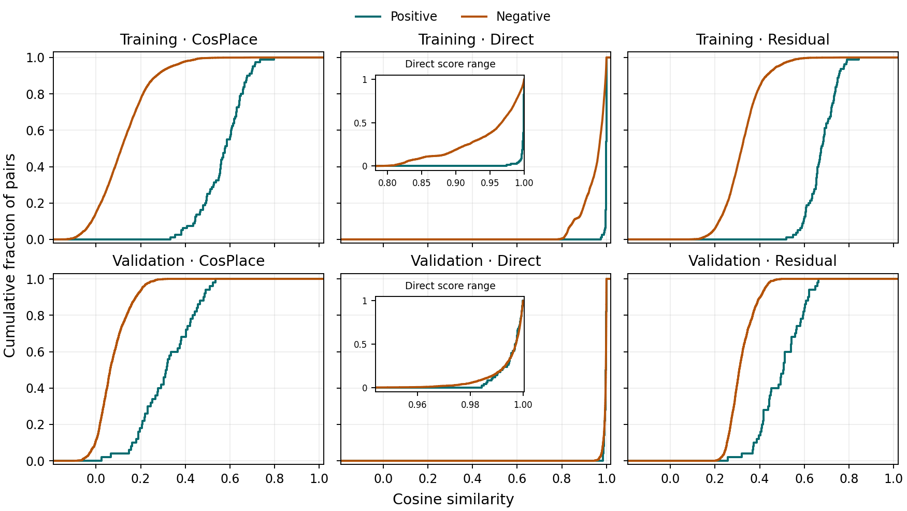
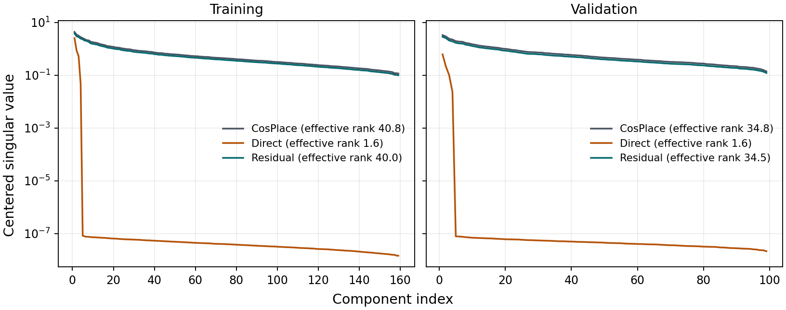
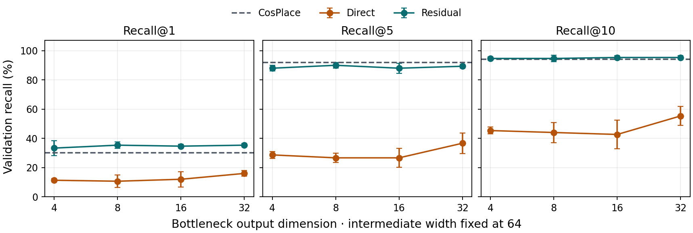

# Classical adapter diagnostics and bottleneck ablation

The original Direct checkpoint shows strong partial collapse on both splits. Its validation descriptors have a mean distinct-image cosine of **0.9956** and effective rank **1.58**, versus **0.1800** and **34.84** for CosPlace. Widening Direct to a 32-dimensional bottleneck recovered some retrieval accuracy. The original four-dimensional Residual model preserves most of the CosPlace geometry and is the appropriate matched baseline for the first quantum residual experiment. Keep the original Direct model as its corresponding direct control.

## Protocol

The runs used frozen Phase 1 CosPlace features from Gardens Point Walking. Training used 80 night queries and 80 day gallery images from frames 000–079. Validation used 50 of each from frames 090–139. The Phase 2 cosine ranking, tie handling, and Recall@K definitions were reused. Only training triplets contributed to updates, and the test split remains held out.

The original seed-0 checkpoints selected in Phase 2 are the reference for the diagnostic figures. The ablation retrained both adapter variants under seeds 42, 123, and 2026. Each of the 30 runs used 50 epochs, Adam with learning rate `0.001`, batch size `16`, margin `0.2`, and one positive and one eligible negative per query per epoch. A gallery frame was eligible as a negative only if it was more than five frames away from every positive for the query. Every run picked the earliest best lexicographic validation tuple `(Recall@1, Recall@5, Recall@10)`. The residual scale was fixed at `0.1`.

In the controlled sweep the first projection ends at width 64, and the nonlinear layer produces the bottleneck output of width 4, 8, 16, or 32. The separate reference repeats use the exact Phase 2 layout with intermediate width 8 and bottleneck output 4. Both variants have the same linear layers and ReLU for a given layout. The residual variant adds the scaled MLP output to the original 512-dimensional vector before normalization.

## Does Direct collapse, and does it learn on training data?

Geometry uses pooled query and gallery rows within each split. Pairwise cosine statistics use every unordered pair of distinct images and report population standard deviations. Total variance is the trace of the population covariance of the normalized descriptors. The spectrum is the SVD of centered rows. Numerical rank counts singular values above `10⁻⁵` times the largest value. Effective rank is `exp(entropy(p))` with `p` proportional to squared singular values.

| Split | Model | Pair cosine mean ± SD | Total variance | Numerical rank | Effective rank |
| --- | --- | ---: | ---: | ---: | ---: |
| Train | CosPlace | 0.1835 ± 0.1821 | 0.8114 | 159 | 40.76 |
| Train | Direct | 0.9527 ± 0.0523 | 0.0470 | 4 | 1.63 |
| Train | Residual | 0.3720 ± 0.1387 | 0.6241 | 159 | 40.03 |
| Validation | CosPlace | 0.1800 ± 0.1773 | 0.8118 | 99 | 34.84 |
| Validation | Direct | 0.9956 ± 0.0059 | 0.0043 | 4 | 1.58 |
| Validation | Residual | 0.3955 ± 0.1332 | 0.5985 | 99 | 34.53 |

The final linear map confines Direct descriptors to the span of its bottleneck columns and output bias, even after normalization. One of the four ReLU units was inactive throughout each split in the seed-0 checkpoint. Its validation variance was about 0.5% of CosPlace’s. The Direct validation positive mean was `0.9955`, with an eligible-negative mean of `0.9945`. The corresponding training means were `0.9981` and `0.9467`. The validation score gap shrank from about `0.0514` on training to `0.0010` on validation, and the distributions overlap heavily. Residual retains the input through the skip connection and preserves nearly all of its effective rank.





| Model | Train R@1 / R@5 / R@10 | Validation R@1 / R@5 / R@10 |
| --- | ---: | ---: |
| CosPlace | 36.25% / 93.75% / 97.50% | 30% / 92% / 94% |
| Direct, epoch 5 | 10.00% / 43.75% / 75.00% | 8% / 12% / 18% |
| Residual, epoch 15 | 37.50% / 97.50% / 100% | 32% / 92% / 96% |

Direct learned some useful training ordering. Its selected checkpoint still trailed CosPlace on all three training cutoffs. Across the three exact-architecture repeats, mean training Recall@1/5/10 rose to `20.00/70.83/94.17`, with validation at `11.33/31.33/50.00`. The evidence supports both loss of retrieval information and a train–validation gap. The two splits come from different segments of one route, so these measurements cannot isolate overfitting from segment difficulty or appearance differences.

## Is a four-dimensional bottleneck too restrictive?

The table and figure report validation means ± sample standard deviations over the three seeds. The sweep dimensions 4, 8, 16, and 32 denote bottleneck outputs. Effective rank and pairwise cosine are validation means over the same seeds. Both variants have the listed parameter count for a given layout.

| Adapter | Intermediate → bottleneck | Parameters | R@1 (%) | R@5 (%) | R@10 (%) | Cosine | Effective rank |
| --- | ---: | ---: | ---: | ---: | ---: | ---: | ---: |
| Direct reference | 8 → 4 | 6,700 | 11.33 ± 4.16 | 31.33 ± 1.15 | 50.00 ± 2.00 | 0.886 | 2.08 |
| Residual reference | 8 → 4 | 6,700 | 34.00 ± 3.46 | 91.33 ± 1.15 | 94.00 ± 2.00 | 0.385 | 34.59 |
| Direct | 64 → 4 | 35,652 | 11.33 ± 1.15 | 28.67 ± 2.31 | 45.33 ± 2.31 | 0.839 | 2.23 |
| Direct | 64 → 8 | 37,960 | 10.67 ± 4.16 | 26.67 ± 3.06 | 44.00 ± 6.93 | 0.857 | 2.46 |
| Direct | 64 → 16 | 42,576 | 12.00 ± 5.29 | 26.67 ± 6.43 | 42.67 ± 9.87 | 0.898 | 2.99 |
| Direct | 64 → 32 | 51,808 | 16.00 ± 2.00 | 36.67 ± 7.02 | 55.33 ± 6.43 | 0.921 | 5.74 |
| Residual | 64 → 4 | 35,652 | 33.33 ± 5.03 | 88.00 ± 2.00 | 94.67 ± 1.15 | 0.395 | 34.62 |
| Residual | 64 → 8 | 37,960 | 35.33 ± 2.31 | 90.00 ± 2.00 | 94.67 ± 2.31 | 0.315 | 34.40 |
| Residual | 64 → 16 | 42,576 | 34.67 ± 1.15 | 88.00 ± 3.46 | 95.33 ± 1.15 | 0.234 | 34.30 |
| Residual | 64 → 32 | 51,808 | 35.33 ± 1.15 | 89.33 ± 1.15 | 95.33 ± 1.15 | 0.204 | 34.26 |



At fixed intermediate width 64, moving from 4 to 32 helped Direct at all cutoffs and more than doubled its effective rank. The effect was nonmonotonic across the other widths. Direct at width 32 still averaged only 16% R@1 and 55.33% R@10, versus CosPlace’s 30% and 94%. Four dimensions are restrictive when the MLP must replace the original descriptor. A larger bottleneck only partially addresses the gap. Four dimensions were adequate for the residual correction in this comparison.

## Does Residual learn meaningful corrections?

Cosine alignment and relative norm statistics below pool both roles. Improved, worsened, and unchanged count changes in each query’s first labeled positive rank relative to original CosPlace, using the full gallery. The seed-0 initialization is an untrained residual with the same architecture and residual scale.

| Checkpoint | Split | α | cos(z, z′) mean ± SD | Relative norm mean ± SD | Improved / worsened / unchanged |
| --- | --- | ---: | ---: | ---: | ---: |
| Trained | Train | 0.1 | 0.8321 ± 0.0130 | 0.6417 ± 0.0341 | 9 / 3 / 68 |
| Trained | Validation | 0.1 | 0.8395 ± 0.0057 | 0.6362 ± 0.0138 | 9 / 9 / 32 |
| Initialization | Validation | 0.1 | 0.8244 ± 0.0058 | 0.6801 ± 0.0012 | 6 / 11 / 33 |

The small multiplier still yielded a correction averaging 64% of the original descriptor norm in validation. Much of the correction is shared across images. Centered RMS was 12.0% of total correction RMS after training and 2.0% at initialization. The trained validation result of `32/92/96` exceeded the initialization’s `26/88/96` at the first two cutoffs, so training learned sample-dependent changes that affect retrieval. The effect relative to original CosPlace was mixed. Nine positive ranks improved and nine worsened, and mean first-positive rank moved from 3.22 to 3.40. In the four-dimensional repeats a two-percentage-point difference represents one validation query. The measurements support geometry preservation more strongly than a general retrieval gain.

## Phase 3 reference

Use frozen CosPlace as the retrieval anchor and the original `512 → 8 → 4 → 512` Residual MLP with fixed `α = 0.1` as the primary matched classical baseline. Keep the same four-dimensional Direct MLP as the matched comparison for a direct quantum design. Wider results describe a classical capacity ablation on one route and can contextualize the four-dimensional comparison.

## Reproduce and inspect

Requires the Phase 1 `train.npz` and `val.npz` caches, their split manifests and positives, and the seed-0 Phase 2 `direct` and `residual` `best.pt` and `history.json` files. The runs here used Python 3.11, PyTorch 2.11.0, macOS ARM64, and one CPU thread. Use a new output directory for a repeat.

```bash
python -m pip install -e '.[diagnostics]'
OMP_NUM_THREADS=1 python -m vpr_baseline.adapter_experiment \
  --dataset-root data/GardensPointWalking \
  --cache-dir artifacts/gardens-point \
  --reference-dir artifacts/gardens-point-adapters \
  --output-dir artifacts/classical-bottleneck
python -m vpr_baseline.adapter_plots artifacts/classical-bottleneck
```

- [Per-run diagnostics](diagnostics.csv) includes training and validation rows, pairwise mean and SD, variance and rank, pair distribution summaries, and residual rank changes.
- [Validation seed summary](seed_summary.csv) has mean and sample SD for Recall@K and collapse indicators by layout and adapter.
- [Singular values](singular_values.csv) records the full pooled train and validation spectra of original CosPlace and the two Phase 2 checkpoints.
- [Exact 24-run export and optimization audit](numerical-results.md) includes the fixed-intermediate sweep's train and validation results, residual diagnostics, and gradient probes.
- The local run directory contains `pair_scores.csv`, all checkpoints and epoch histories, and the regenerated figures.
