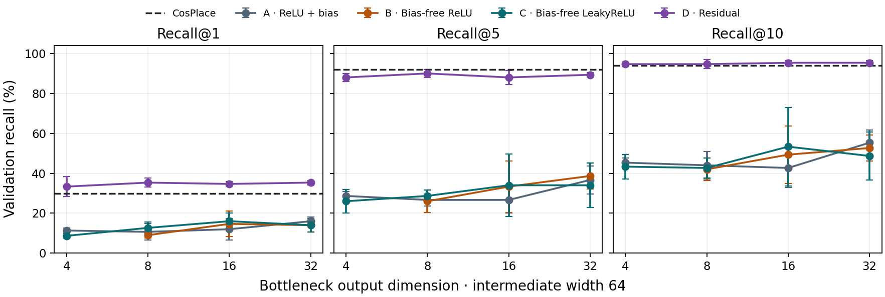
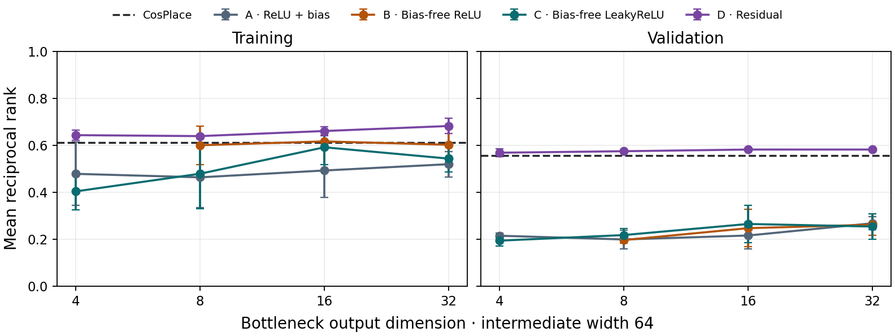

# Task 02.3 · Final classical benchmark

Freeze **C, the bias-free LeakyReLU Direct MLP**, as the trainable four-dimensional bias-free control. Retain A as the original Direct reference and D as the matched Residual control. On the primary `64 → 4` layout, C completed 3/3 seeds and reached mean validation Recall@1 of 8.67% and MRR of 0.1948. D reached 33.33% and 0.5690, compared with 30.00% and 0.5563 for frozen CosPlace. D improved MRR in two of three four-dimensional seeds. Its mean Recall@5 fell from 92.00% to 88.00%.

## Evaluation and provenance

This benchmark re-evaluates **55 saved adapter checkpoints** and the frozen CosPlace baseline on the existing train and validation caches. It also records **five archived zero-descriptor failures**. All histories and checkpoints for successful runs were available. Failed runs have empty retrieval metrics. The untrained Residual initialization was a diagnostic control. The historical `8 → 4` experiments contain A, B, and D, and C was evaluated only in the primary width-64 study.

The primary sweep groups intermediate width 64 and bottlenecks 4, 8, 16, and 32 over seeds 42, 123, and 2026. The historical repeats group the same seeds at intermediate width 8 and bottleneck 4. Seed-0 historical runs used a shorter early-stopping patience and are reported separately. The saved checkpoints were selected by the earliest best validation tuple (Recall@1, Recall@5, Recall@10). This task performs descriptor inference and ranking from the saved weights. It leaves the test split held out and uses training ranks only as retrospective diagnostics.

Each query ranks the complete gallery by cosine similarity, with manifest order breaking ties. MRR averages the reciprocal of the rank of the first labeled positive. With a single positive at rank `r`, average precision is the precision at that positive, `1/r`, so **AP equals reciprocal rank and mAP equals MRR** for this dataset protocol. The MRR implementation also accepts multiple labeled positives and uses the earliest one. CosPlace's training Recall@1/5/10 is 36.25% / 93.75% / 97.50% and its training MRR is 0.6124.

| Arm | Adapter |
| --- | --- |
| A | Direct with ReLU and an up-projection bias |
| B | Bias-free Direct with ReLU |
| C | Bias-free Direct with LeakyReLU at slope 0.01 |
| D | Residual MLP with fixed alpha 0.1 |

- [Detailed experiments](experiments.csv) includes train and validation scores, diagnostics, archived status, checkpoint epoch and SHA-256, and parameter count.
- [Multi-seed summary](multi_seed_summary.csv) includes separate train and validation means, sample SDs, completion counts, and representation diagnostics.
- [Paired four-dimensional summary](paired_d4_summary.csv) and [per-query ranks](paired_d4_query_ranks.csv) preserve the same validation queries across all nine successful primary runs.

## Final validation benchmark

Recall is in percent. Recall SD is in percentage points. MRR is on the 0–1 scale. Mean ± sample SD uses only successfully evaluated checkpoints. The CosPlace row is a single fixed evaluation.

| Model | Bottleneck | Successful seeds | Val R@1 | Val R@5 | Val R@10 | Val MRR | Effective rank |
| --- | ---: | ---: | ---: | ---: | ---: | ---: | ---: |
| CosPlace | — | Fixed | 30.00 | 92.00 | 94.00 | 0.5563 | 34.84 |
| A | 4 | 3/3 | 11.33 ± 1.15 | 28.67 ± 2.31 | 45.33 ± 2.31 | 0.2157 ± 0.0123 | 2.23 ± 0.24 |
| A | 8 | 3/3 | 10.67 ± 4.16 | 26.67 ± 3.06 | 44.00 ± 6.93 | 0.1998 ± 0.0401 | 2.46 ± 1.16 |
| A | 16 | 3/3 | 12.00 ± 5.29 | 26.67 ± 6.43 | 42.67 ± 9.87 | 0.2167 ± 0.0563 | 2.99 ± 0.84 |
| A | 32 | 3/3 | 16.00 ± 2.00 | 36.67 ± 7.02 | 55.33 ± 6.43 | 0.2687 ± 0.0276 | 5.74 ± 3.15 |
| B | 4 | 0/3 | — | — | — | — | — |
| B | 8 | 2/3 | 9.00 ± 1.41 | 26.00 ± 5.66 | 42.00 ± 5.66 | 0.1973 ± 0.0134 | 3.35 ± 1.11 |
| B | 16 | 3/3 | 14.67 ± 6.43 | 33.33 ± 12.86 | 49.33 ± 14.47 | 0.2479 ± 0.0792 | 5.20 ± 0.72 |
| B | 32 | 3/3 | 14.00 ± 3.46 | 38.67 ± 6.43 | 52.67 ± 6.43 | 0.2627 ± 0.0455 | 8.96 ± 1.23 |
| C | 4 | 3/3 | 8.67 ± 1.15 | 26.00 ± 6.00 | 43.33 ± 6.11 | 0.1948 ± 0.0222 | 1.73 ± 0.47 |
| C | 8 | 3/3 | 12.67 ± 3.06 | 28.67 ± 3.06 | 42.67 ± 5.03 | 0.2185 ± 0.0279 | 3.18 ± 1.32 |
| C | 16 | 3/3 | 16.00 ± 4.00 | 34.00 ± 15.62 | 53.33 ± 19.63 | 0.2657 ± 0.0793 | 4.72 ± 0.75 |
| C | 32 | 3/3 | 14.00 ± 3.46 | 34.00 ± 11.14 | 48.67 ± 12.06 | 0.2549 ± 0.0531 | 9.31 ± 1.05 |
| D | 4 | 3/3 | 33.33 ± 5.03 | 88.00 ± 2.00 | 94.67 ± 1.15 | 0.5690 ± 0.0171 | 34.62 ± 0.22 |
| D | 8 | 3/3 | 35.33 ± 2.31 | 90.00 ± 2.00 | 94.67 ± 2.31 | 0.5754 ± 0.0048 | 34.40 ± 0.41 |
| D | 16 | 3/3 | 34.67 ± 1.15 | 88.00 ± 3.46 | 95.33 ± 1.15 | 0.5825 ± 0.0050 | 34.30 ± 0.25 |
| D | 32 | 3/3 | 35.33 ± 1.15 | 89.33 ± 1.15 | 95.33 ± 1.15 | 0.5825 ± 0.0056 | 34.26 ± 0.28 |

### Historical intermediate-width-8 runs

All rows below have bottleneck 4. Seed-0 scores are single evaluations. The other rows summarize the full successful set for seeds 42, 123, and 2026.

| Model | Cohort | Successful seeds | Val R@1 | Val R@5 | Val R@10 | Val MRR | Effective rank |
| --- | --- | ---: | ---: | ---: | ---: | ---: | ---: |
| A | Seed 0 | 1/1 | 8.00 | 12.00 | 18.00 | 0.1341 | 1.58 |
| A | Repeats | 3/3 | 11.33 ± 4.16 | 31.33 ± 1.15 | 50.00 ± 2.00 | 0.2301 ± 0.0201 | 2.08 ± 0.17 |
| B | Seed 0 | 1/1 | 4.00 | 12.00 | 22.00 | 0.1060 | 1.94 |
| B | Repeats | 2/3 | 11.00 ± 7.07 | 23.00 ± 9.90 | 34.00 ± 14.14 | 0.1980 ± 0.0881 | 1.85 ± 0.33 |
| D | Seed 0 | 1/1 | 32.00 | 92.00 | 96.00 | 0.5553 | 34.53 |
| D | Repeats | 3/3 | 34.00 ± 3.46 | 91.33 ± 1.15 | 94.00 ± 2.00 | 0.5780 ± 0.0177 | 34.59 ± 0.37 |

### Completion rates

| Arm | Primary successful / attempted | Historical successful / attempted | All zero-descriptor failures |
| --- | ---: | ---: | ---: |
| A | 12/12 | 4/4 | 0 |
| B | 8/12 | 3/4 | 5 |
| C | 12/12 | — | 0 |
| D | 12/12 | 4/4 | 0 |

B's primary failures are all three width-4 seeds and width-8 seed 2026. Its historical failure is `8 → 4` seed 42. Performance averages exclude all five failures. In particular, B width 8 averages two seeds and should be compared with the same seed subset for a paired claim.

The figures show mean ± sample SD over successful seeds. B has a gap at width 4.





## Representation diagnostics

The table gives means for the primary bottleneck-4 runs, grouped by split. Variance is the trace of the population covariance of pooled unit descriptors. Effective rank is the exponential entropy of the squared centered singular values. Negatives are gallery frames outside the original five-frame window around each query's positives. The pair gap is the positive mean minus the eligible-negative mean. Retrieval still ranks the complete gallery. The CSVs contain the same diagnostics for every width and historical checkpoint.

| Model | Split | Distinct-image cosine | Variance | Effective rank | Positive cosine | Negative cosine | Pair gap |
| --- | --- | ---: | ---: | ---: | ---: | ---: | ---: | ---: |
| CosPlace | Train | 0.1835 | 0.8114 | 40.7569 | 0.5711 | 0.1221 | 0.4490 |
| CosPlace | Val | 0.1800 | 0.8118 | 34.8407 | 0.3182 | 0.0759 | 0.2422 |
| A | Train | 0.4188 | 0.5776 | 2.5917 | 0.9939 | 0.3468 | 0.6470 |
| A | Val | 0.8388 | 0.1595 | 2.2323 | 0.9247 | 0.8248 | 0.0998 |
| C | Train | 0.2986 | 0.6970 | 2.1127 | 0.9769 | 0.2133 | 0.7636 |
| C | Val | 0.6535 | 0.3430 | 1.7316 | 0.8179 | 0.6138 | 0.2042 |
| D | Train | 0.3727 | 0.6234 | 38.9897 | 0.6853 | 0.3237 | 0.3616 |
| D | Val | 0.3952 | 0.5988 | 34.6222 | 0.4990 | 0.3182 | 0.1808 |

For D at bottleneck 4, mean alignment with the original descriptors was 0.8298 on train and 0.8433 on validation. Mean relative correction norm ‖αΔz‖/‖z‖ was 0.6544 and 0.6300, respectively, with fixed alpha 0.1. First-positive ranks improved, worsened, or stayed unchanged in 31, 6, and 203 of 240 training query evaluations across seeds, and in 18, 24, and 108 of 150 validation query evaluations. These counts reuse the same underlying queries in each seed. The detailed CSV includes residual measurements for each split and seed at all evaluated widths.

## Paired four-dimensional validation comparison

Each row compares all 50 queries to their original CosPlace first-positive ranks. A gain at a cutoff means the query entered top K. A loss means it left top K. Mean change in reciprocal rank is the adapter rank reciprocal minus the baseline rank reciprocal, averaged over those same queries. Every successful primary bottleneck-4 checkpoint is represented below. The paired data carries both ranks and the query ID for future comparisons.

| Model | Seed | Improved | Worsened | Unchanged | Mean Δ reciprocal rank | R@1 gains / losses | R@5 gains / losses |
| --- | ---: | ---: | ---: | ---: | ---: | ---: | ---: |
| A | 42 | 7 | 41 | 2 | −0.353968 | 5 / 15 | 1 / 34 |
| A | 123 | 7 | 41 | 2 | −0.329722 | 4 / 13 | 2 / 33 |
| A | 2026 | 7 | 41 | 2 | −0.337950 | 4 / 13 | 0 / 31 |
| C | 42 | 7 | 41 | 2 | −0.339613 | 4 / 15 | 1 / 31 |
| C | 123 | 4 | 40 | 6 | −0.360838 | 2 / 12 | 0 / 33 |
| C | 2026 | 6 | 42 | 2 | −0.384054 | 4 / 15 | 1 / 37 |
| D | 42 | 5 | 6 | 39 | +0.016138 | 2 / 0 | 0 / 3 |
| D | 123 | 6 | 8 | 36 | −0.005759 | 0 / 1 | 0 / 1 |
| D | 2026 | 7 | 10 | 33 | +0.027966 | 4 / 0 | 0 / 2 |

## Pre-quantum readiness

- **Direct and LeakyReLU.** C is the most reliable bias-free Direct control at four dimensions. It addressed B's zero descriptors in all three matched seeds. Compared with A at the same width, C increased angular spread and the positive–negative gap, while effective rank, Recall@K, and MRR fell. The clearest benefit is training stability. At width 16, C also improved the mean retrieval metrics over A and B.
- **Residual consistency.** D preserves the original effective rank. Across all 12 primary D runs, 11 raised validation MRR and 11 raised Recall@1 over CosPlace. At Recall@5, one run tied CosPlace and 11 were lower. Improvements depend on the metric and seed, so retain frozen CosPlace as the anchor.
- **Bottleneck width.** Wider Direct variants substantially raise MRR in this sweep, with nonmonotonic results. C's mean MRR rises from 0.1948 at width 4 to 0.2657 at 16, then falls to 0.2549 at 32 even as effective rank rises from 4.72 to 9.31. D varies less, with mean validation MRR spanning 0.5690 to 0.5825 while preserving roughly 34 effective dimensions.
- **Limits.** One validation query changes Recall@K by **two percentage points**. The three seeds share 50 validation queries from a held-out segment of one campus route. Checkpoints were selected on that validation set, and the SD describes seed variability on the same queries. These results support choosing controls for the next experiment. Small numerical differences provide limited evidence about generalization.
- **Settings to freeze.** Keep the frozen 512-dimensional CosPlace features, splits, exact-frame positives, and five-frame training negative exclusion. Use the same triplet sampler with seeds 42, 123, and 2026, Adam at learning rate 0.001, batch size 16, margin 0.2, 50 epochs with patience 50, and the same validation checkpoint rule. Use comparable `512 → 64 → 4 → 512` projections for Direct and Residual. Keep C at LeakyReLU slope 0.01 with an unbiased up-projection, and D at ReLU with its existing biased up-projection and alpha 0.1. Retain A as a separate reference. Matching data, interfaces, and training protocol establishes architectural fairness. Resource fairness is a separate comparison. Already, C and D have 35,140 and 35,652 trainable parameters, respectively. For future circuit experiments record parameter counts, circuit evaluations, runtime, and measurement shots separately from retrieval quality.

## Reproduce

Use the frozen train and validation caches and the saved checkpoints from the classical bottleneck, Phase 2, Direct bias, and LeakyReLU studies. The exports were generated with Python 3.11 and PyTorch 2.11.0 on a single CPU thread. Use a fresh output directory.

```bash
python -m pip install -e '.[diagnostics]'
OMP_NUM_THREADS=1 python experiments/classical-bottleneck/run_final_benchmark.py \
  --dataset-root data/GardensPointWalking --artifacts-dir artifacts \
  --output-dir artifacts/final-classical-evaluation
python experiments/classical-bottleneck/plot_final_benchmark.py artifacts/final-classical-evaluation

vpr-baseline evaluate --dataset-root data/GardensPointWalking \
  --cache-dir artifacts/gardens-point --split val --mrr
```
