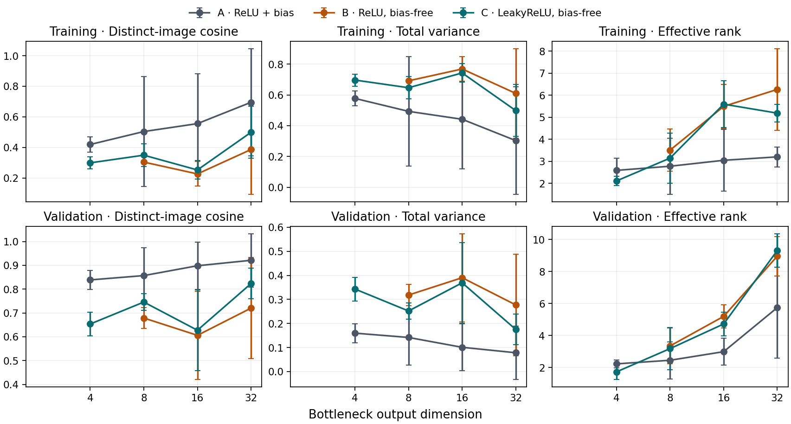
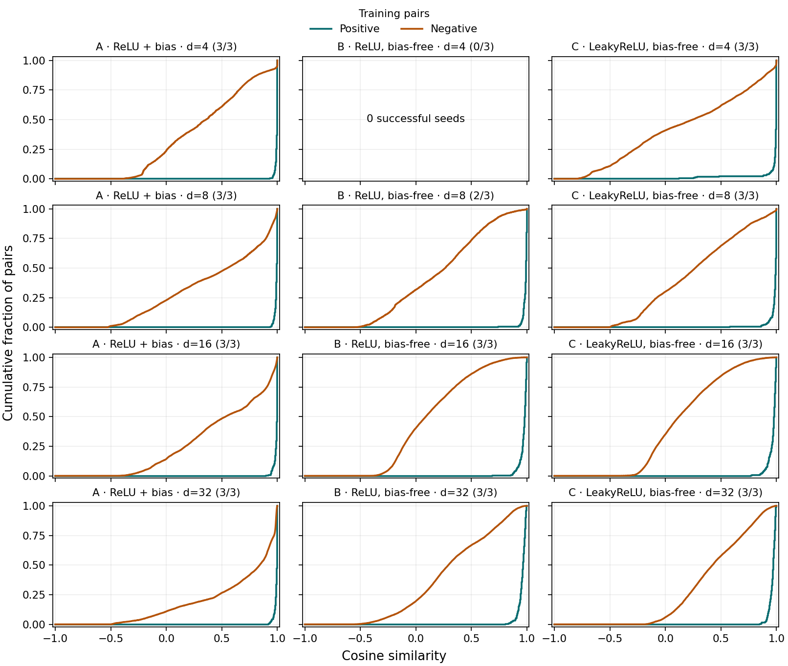
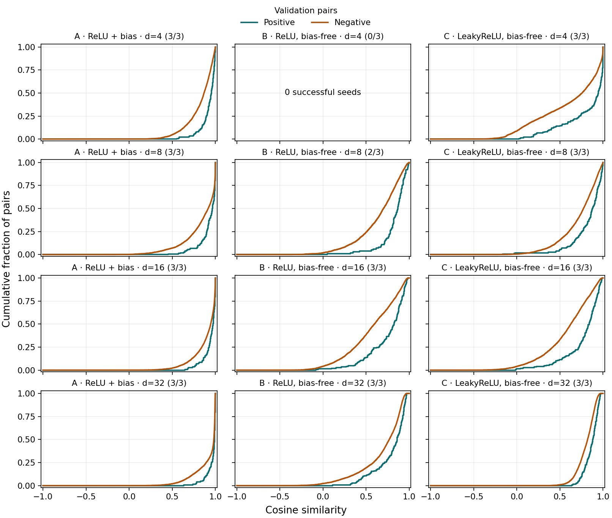

# Task 02.2 · Direct LeakyReLU ablation

LeakyReLU made the bias-free `64 → 4` Direct adapter trainable for all three seeds. Across widths, **12/12** LeakyReLU runs completed, compared with **8/12** archived bias-free ReLU runs. The four-dimensional LeakyReLU model spread descriptors out more than biased ReLU and had lower effective rank and lower mean validation Recall@K. It is a practical matched control for a four-dimensional bias-free Quantum Direct experiment. The original biased ReLU remains the reference for retrieval performance.

## Protocol and provenance

| Configuration | Bottleneck activation | Up-projection bias | Runs |
| --- | --- | --- | --- |
| A | ReLU | Enabled | 12 archived |
| B | ReLU | Disabled | 12 archived, including four failures |
| C | LeakyReLU, slope 0.01 | Disabled | 12 newly trained |

All arms use `512 → 64 → d → 512` with `d ∈ {4, 8, 16, 32}` and seeds 42, 123, and 2026. Shared parameters have identical seeded initial values, verified tensor by tensor. The training sampler uses a separate generator with the same seed and samples one positive and one eligible negative per query per epoch. The five-frame temporal exclusion, margin 0.2, Adam learning rate 0.001, batch size 16, and 50-epoch budget match the prior runs. Selection uses the earliest best validation tuple (Recall@1, Recall@5, Recall@10).

A and B reuse the [Direct bias study](../direct-bias-results.md). Their saved histories and train and validation results were checked against the archived protocol and metrics. Additional activation and pair-distribution diagnostics came from their saved checkpoints and reconstructed initialization. C uses the same frozen CosPlace caches for 80 training queries and 80 gallery images, with validation on 50 queries and 50 gallery images. Only the training split contributed gradients. The test split stayed held out. The run used Python 3.11, PyTorch 2.11.0, macOS ARM64 CPU, and one thread.

## Failure rates and zero counts

| Bottleneck | A failed / attempted | B failed / attempted | C failed / attempted |
| ---: | ---: | ---: | ---: |
| 4 | 0/3 (0%) | 3/3 (100%) | 0/3 (0%) |
| 8 | 0/3 (0%) | 1/3 (33.3%) | 0/3 (0%) |
| 16 | 0/3 (0%) | 0/3 (0%) | 0/3 (0%) |
| 32 | 0/3 (0%) | 0/3 (0%) | 0/3 (0%) |
| All | 0/12 (0%) | 4/12 (33.3%) | 0/12 (0%) |

All C runs completed 50 epochs with strict L2 normalization. The observed zero-activation fraction and zero-norm descriptor count were both zero for C on train and validation at initialization and the selected checkpoints. B had one zero-norm training descriptor at initialization for width 4 and seed 2026. Each of its four failed runs stopped at the first forward pass containing a zero descriptor. Three stopped during training and one during validation. The CSV records the first failing epoch, split, and batch count. LeakyReLU preserves negative preactivations, but an exactly zero bottleneck or a projection that maps a nonzero bottleneck to zero can still trigger the detector. The unit tests exercise the latter case.

## Recall@K across successful seeds

The tables give mean recall in percent ± sample SD in percentage points. Each mean uses successful runs within its arm and width. Width 8 has two B seeds (42 and 123), so cross-arm paired comparisons at that width use those two seeds. Width 4 has no successful B seed. [Per-run comparison](comparison.csv) · [Full-precision aggregates](summary.csv)

### Validation

| Arm | Bottleneck | Successful | Recall@1 | Recall@5 | Recall@10 |
| --- | ---: | ---: | ---: | ---: | ---: |
| A | 4 | 3/3 | 11.33 ± 1.15 | 28.67 ± 2.31 | 45.33 ± 2.31 |
| A | 8 | 3/3 | 10.67 ± 4.16 | 26.67 ± 3.06 | 44.00 ± 6.93 |
| A | 16 | 3/3 | 12.00 ± 5.29 | 26.67 ± 6.43 | 42.67 ± 9.87 |
| A | 32 | 3/3 | 16.00 ± 2.00 | 36.67 ± 7.02 | 55.33 ± 6.43 |
| B | 4 | 0/3 | — | — | — |
| B | 8 | 2/3 | 9.00 ± 1.41 | 26.00 ± 5.66 | 42.00 ± 5.66 |
| B | 16 | 3/3 | 14.67 ± 6.43 | 33.33 ± 12.86 | 49.33 ± 14.47 |
| B | 32 | 3/3 | 14.00 ± 3.46 | 38.67 ± 6.43 | 52.67 ± 6.43 |
| C | 4 | 3/3 | 8.67 ± 1.15 | 26.00 ± 6.00 | 43.33 ± 6.11 |
| C | 8 | 3/3 | 12.67 ± 3.06 | 28.67 ± 3.06 | 42.67 ± 5.03 |
| C | 16 | 3/3 | 16.00 ± 4.00 | 34.00 ± 15.62 | 53.33 ± 19.63 |
| C | 32 | 3/3 | 14.00 ± 3.46 | 34.00 ± 11.14 | 48.67 ± 12.06 |

### Training

The same checkpoints selected on validation were evaluated against the training gallery.

| Arm | Bottleneck | Successful | Recall@1 | Recall@5 | Recall@10 |
| --- | ---: | ---: | ---: | ---: | ---: |
| A | 4 | 3/3 | 27.92 ± 12.01 | 75.42 ± 19.38 | 87.50 ± 17.50 |
| A | 8 | 3/3 | 22.50 ± 10.68 | 80.00 ± 18.41 | 92.50 ± 10.90 |
| A | 16 | 3/3 | 27.08 ± 11.27 | 80.83 ± 12.83 | 95.00 ± 7.60 |
| A | 32 | 3/3 | 30.00 ± 6.61 | 82.50 ± 5.73 | 98.33 ± 1.44 |
| B | 4 | 0/3 | — | — | — |
| B | 8 | 2/3 | 40.00 ± 7.07 | 89.38 ± 9.72 | 96.88 ± 4.42 |
| B | 16 | 3/3 | 40.00 ± 2.17 | 95.00 ± 3.31 | 99.58 ± 0.72 |
| B | 32 | 3/3 | 38.33 ± 8.51 | 92.50 ± 4.51 | 99.58 ± 0.72 |
| C | 4 | 3/3 | 22.08 ± 5.64 | 66.25 ± 11.46 | 82.92 ± 13.77 |
| C | 8 | 3/3 | 27.50 ± 15.36 | 74.58 ± 17.74 | 92.08 ± 9.46 |
| C | 16 | 3/3 | 36.67 ± 7.32 | 95.83 ± 4.39 | 100.00 ± 0.00 |
| C | 32 | 3/3 | 31.25 ± 7.60 | 90.00 ± 2.17 | 99.17 ± 0.72 |

## Descriptor diversity and retrieval

The geometry plot uses the mean ± sample SD across successful seeds. Variance is the trace of the population covariance of the pooled unit descriptors. Effective rank is the exponential entropy of the squared centered singular values. The pair plots show empirical CDFs over positive and eligible negative cosine scores pooled across successful seeds in each panel. The CSV also includes per-run pair counts, means, population SDs, and the 5th, 50th, and 95th percentiles. Failed runs have blank selected-checkpoint metrics.







- **Against A, C increases angular spread at every width on average.** At width 4, validation cosine fell from 0.839 to 0.654 and variance rose from 0.160 to 0.343. Effective rank fell from 2.23 to 1.73, so the larger spread occupied fewer effective directions. At widths 8, 16, and 32, C also increased mean validation effective rank over A.
- **Against B, the clearest benefit is reliability.** In the eight seed pairs where both arms completed, C had lower mean validation variance at each comparable width. Effective rank was slightly lower at widths 8 and 16 and higher at 32. The change from B to C did not uniformly increase descriptor diversity.
- **Geometry gains and Recall@K diverged.** C improved all three validation means over A and B at width 16, reaching 16.00%, 34.00%, and 53.33%. At width 4 it completed all three seeds and mean Recall@1 was 8.67% versus 11.33% for A. At width 32 its effective rank exceeded both controls and mean Recall@5/10 were lower than both. At matched width-8 seeds, C gained 5, 3, and 1 percentage points over B at Recall@1/5/10. All C means remain below the original CosPlace validation results of 30%, 92%, and 94%.

The `64 → 4` C configuration is a more suitable control than B for a bias-free four-dimensional Quantum Direct comparison because every seed trained and produced valid descriptors. Its retrieval results on this 50-query same-route validation split support retaining A as the original Direct reference. The wider results describe this ablation and carry substantial seed variability.

## Reproduce

Use the Phase 1 train and validation caches and the saved artifacts from the [bias study](../direct-bias-results.md). The runner loads the archived A/B checkpoints or failure records, trains C, and exports the raw pair scores alongside the comparison and summary CSVs. Use a fresh output directory for each run.

```bash
python -m pip install -e '.[diagnostics]'
OMP_NUM_THREADS=1 python experiments/classical-bottleneck/run_direct_leaky_relu.py \
  --dataset-root data/GardensPointWalking \
  --cache-dir artifacts/gardens-point \
  --bias-dir artifacts/direct-up-bias \
  --output-dir artifacts/direct-leaky-relu
python experiments/classical-bottleneck/plot_direct_leaky_relu.py artifacts/direct-leaky-relu
```

For an individual Direct run, use `train-adapter --activation leaky_relu --no-up-bias` with the matched training flags. Existing checkpoints default to ReLU when they lack the activation field.
